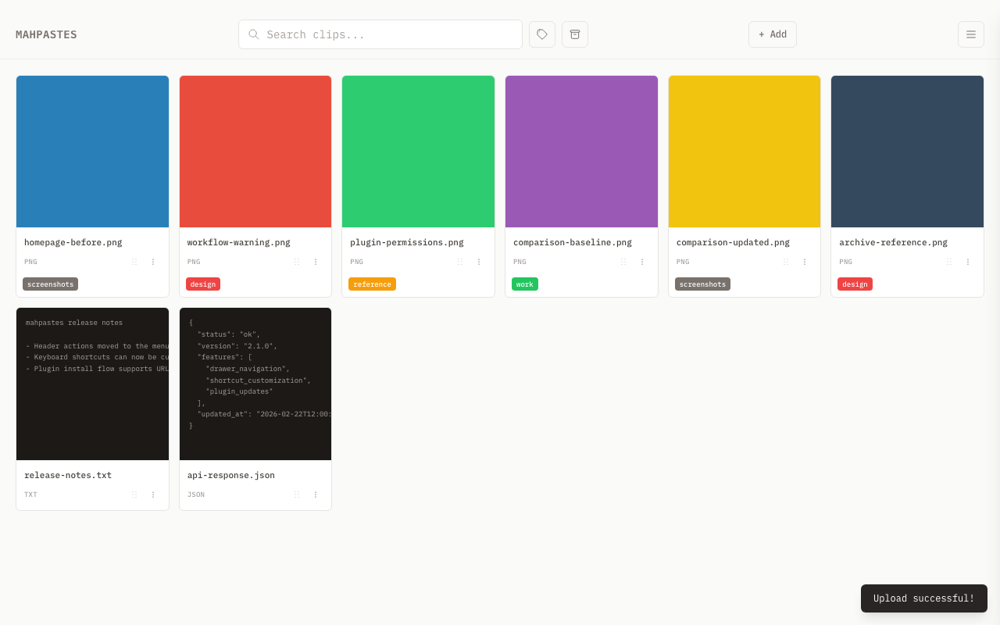

# mahpastes

A local clipboard manager for macOS, Windows, and Linux. Store, organize, and quickly access your copied content.




Documentation: https://egeozcan.github.io/mahpastes/

## Features

- **Paste Anything** — Images, text, code, JSON, HTML, and files (paste or drag & drop)
- **Fast Navigation** — Keyboard-first workflow with drawer + modal shortcuts and a built-in cheatsheet (`?`)
- **Custom Shortcuts** — Rebind key mappings from **Settings > Shortcuts**
- **Archive** — Keep important clips separate from your active workspace
- **Tags** — Tag clips, filter by tag, and hide noisy tags from default gallery view
- **Image Editor** — Annotate images with brush, shapes, and text tools
- **Text Editor** — Edit text and code clips directly
- **Image Comparison** — Compare two images with fade, slider, or diff modes
- **Bulk Actions** — Select multiple clips to tag, archive, download, or delete
- **Search** — Filter clips by filename or type
- **Watch Folders** — Auto-import files from monitored directories
- **Plugin System** — Install and manage Lua plugins from the dedicated Plugins modal
- **`mp` CLI** — Upload, search, tag, pipe and back up clips from the terminal ([CLI workflow](docs/docs/tutorials/cli-workflow.md)); see the [integration recipes](docs/docs/tutorials/integration-recipes.md) for shell, fzf, tmux, vim, git, file-manager and macOS Quick Action snippets
- **REST API** — Local, key-authenticated HTTP API with viewer/editor/admin roles and tag-scoped keys ([REST API](docs/docs/features/rest-api.md))
- **Headless Server** — `mahpastesd` runs the same API and a web UI without the desktop app ([setup](docs/docs/tutorials/integration-recipes.md#without-the-desktop-app-mahpastesd))
- **Claude Code Plugin** — Lets Claude Code store artifacts, host sites and search clips through the API ([skill](skills/mahpastes/SKILL.md), [commands](commands/); run `/mahpastes:setup` to connect)
- **Backup & Restore** — Export and import all data as a ZIP archive
- **Copy Path** — Create a temp file and copy its path to clipboard
- **Export** — Save individual clips or download multiple as a ZIP
- **Auto-Delete Engine** — Backend expiration support is implemented; per-clip expiration controls are being surfaced in UI
- **Headless Server** — Run `mahpastesd` under systemd or in a container; see [docs/docs/features/headless-server.md](docs/docs/features/headless-server.md)

## Installation

### Download Release

Download the latest release from the [Releases](https://github.com/egeozcan/mahpastes/releases) page:

- **macOS** (13+, universal): `mahpastes-macos-universal.zip`, signed and notarized, with Finder integration. Drag `mahpastes.app` to Applications.
- **Windows** (x64 or ARM): `mahpastes-windows-amd64-installer.exe` (or `arm64`) installs with Start Menu shortcuts; `mahpastes-windows-amd64.zip` or `mahpastes-windows-arm64.zip` is the portable archive; `scoop install https://github.com/egeozcan/mahpastes/releases/latest/download/mahpastes.json` also works. See `packaging/README.md` for the Scoop and Homebrew manifests.
- **Linux** (x64; GTK 3, WebKitGTK 4.1, glibc 2.39+: Ubuntu 24.04, Debian 13, Fedora 40 and later): `mahpastes-linux-amd64.tar.gz`. Extract and run `./install.sh`, which installs the app and `mp` to `~/.local/bin` with a desktop entry and icon (`./install.sh --uninstall` removes them).
- **Standalone** `mp` CLI and `mahpastesd` headless server for each platform, plus `SHA256SUMS` to verify downloads.

Every app archive includes the `mp` CLI, the bundled plugins and examples. See the [installation guide](docs/docs/getting-started/installation.md) for details.

### Build from Source

#### Prerequisites

- [Go](https://go.dev/dl/) 1.25.7+ (fetches the 1.26.6 toolchain go.mod asks for)
- [Wails CLI](https://wails.io/docs/gettingstarted/installation) v2.12.0
- [Node.js](https://nodejs.org/) 18+

```bash
# Install Wails CLI
go install github.com/wailsapp/wails/v2/cmd/wails@v2.12.0
```

#### Build

```bash
# Clone the repository
git clone https://github.com/egeozcan/mahpastes.git
cd mahpastes

# Build for your platform
wails build

# The app will be in build/bin/
```

#### Platform-specific builds

```bash
# macOS (Universal - Intel + Apple Silicon)
wails build -platform darwin/universal

# Windows
wails build -platform windows/amd64

# Linux (WebKitGTK 4.1: Ubuntu 24.04+, Debian 13, Fedora 40+)
wails build -platform linux/amd64 -tags webkit2_41
```

### Install on macOS

After building, copy to Applications:

```bash
cp -R build/bin/mahpastes.app /Applications/
```

### Install on Linux

`make install` builds and installs for the current user, without root:
the app goes to `~/.local/bin/mahpastes` and the `mp` CLI to `~/.local/bin/mp`
(when Go is available on the host), with a desktop entry, icons, `mp` shell
completions (bash, zsh, and fish when installed) and `mp` man pages under
`~/.local/share`. Set `PREFIX` to install elsewhere. `make uninstall` removes
them again and keeps your data. On other systems, `make mp-install` installs
just `mp` with its completions and man pages, and `make mp-uninstall` removes them.

Build dependencies:

```bash
# Ubuntu / Debian
sudo apt install build-essential pkg-config libgtk-3-dev libwebkit2gtk-4.1-dev nodejs npm
# Fedora
sudo dnf install golang nodejs npm gcc pkgconf-pkg-config gtk3-devel webkit2gtk4.1-devel
# Arch
sudo pacman -S --needed go nodejs npm base-devel pkgconf gtk3 webkit2gtk-4.1
```

The build picks WebKitGTK 4.1 when it is installed and falls back to 4.0
(for example on Ubuntu 22.04). Distribution Go packages can be older than
`go.mod` requires. Go 1.21 or newer downloads the right toolchain itself;
otherwise install Go from [go.dev](https://go.dev/dl/).

On image-based systems (Silverblue, Kinoite, Bazzite, Bluefin), build inside
a [distrobox](https://distrobox.it/) or toolbox container named
`mahpastes-dev` (override with `DEV_CONTAINER`). When the host lacks the
toolchain, `make build`, `make dev` and `make install` build in that container
automatically and install on the host. The installed app only needs the GTK 3
and WebKitGTK runtime libraries, which these desktops already ship.

Browsing clips in the file manager additionally needs the `fuse3` package at
runtime (see [File manager access on Linux](docs/FILE_PROVIDER.md#linux-file-manager-access)).

## Development

```bash
# Install dependencies
cd frontend && npm install && cd ..

# Run in development mode
wails dev
```

The app will open and hot-reload when you make changes to the frontend.

A `Makefile` provides shortcuts for common operations:

```bash
make dev        # Start dev server with hot reload
make build      # Clean production build
make install    # Build, kill running app, install (/Applications, ~/.local on Linux, %LOCALAPPDATA%\Programs on Windows), launch
make test       # Run e2e tests
make screenshots # Refresh documentation screenshots
make help       # Show all targets
```

On macOS, `make build` and `make install` include Finder integration when the
[signing configuration](docs/FILE_PROVIDER.md#build-and-install) is present, using
Apple Command Line Tools. Without it, they warn and build the ordinary app.
On Linux the same Settings section mounts the clips as a read-only folder
instead; it needs no build options. Windows keeps the ordinary Wails build.
Use `wails build` directly for a macOS build without Finder integration.

### Project Structure

```
mahpastes/
├── main.go             # App entry point
├── app.go              # Core application logic and API
├── backup.go           # ZIP backup and restore
├── database.go         # SQLite database setup and cleanup
├── plugin_service.go   # Plugin frontend API
├── plugins.go          # Plugin install/uninstall helpers
├── watcher.go          # Watch folder implementation
├── Makefile            # Build, install, test targets
├── wails.json          # Wails configuration
├── plugin/             # Lua plugin system
├── plugins/            # Bundled example plugins
├── build/              # Build assets and output
│   ├── appicon.png
│   └── bin/            # Built binaries
├── frontend/
│   ├── index.html      # Main UI
│   ├── css/            # Stylesheets
│   ├── js/             # JavaScript modules
│   └── tailwind.config.js
└── e2e/                # Playwright e2e tests
```

### Frontend Stack

- Vanilla JavaScript (no framework)
- Tailwind CSS
- IBM Plex Mono font

### Backend

- Go with Wails v2
- SQLite database (WAL mode)
- System clipboard integration via `golang.design/x/clipboard`

## Data Storage

Data is stored in platform-specific locations:

| Platform | Location |
|----------|----------|
| macOS    | `~/Library/Application Support/mahpastes/` |
| Windows  | `%APPDATA%\mahpastes\` |
| Linux    | `~/.config/mahpastes/` |

The database file is `clips.db`. Temporary files are stored in `clip_temp_files/` and cleaned up on app exit.

## Keyboard Shortcuts

Shortcuts are configurable from **Settings > Shortcuts**.

| Shortcut | Action |
|----------|--------|
| `?` | Open keyboard shortcut cheatsheet |
| `M` | Open menu drawer |
| `,` | Open settings |
| `P` | Open plugins |
| `A` | Toggle archive view |
| `W` | Open watch view |
| `/` | Focus search |
| `Cmd/Ctrl + V` | Paste from clipboard |
| `Escape` | Close modal, drawer, or cheatsheet |

### Image Editor

| Shortcut | Tool |
|----------|------|
| `B` | Brush |
| `L` | Line |
| `R` | Rectangle |
| `C` | Circle |
| `T` | Text |
| `E` | Eraser |
| `Cmd/Ctrl + Z` | Undo |
| `Cmd/Ctrl + Y` | Redo |

Full shortcut reference: https://egeozcan.github.io/mahpastes/getting-started/keyboard-shortcuts

## License

MIT
